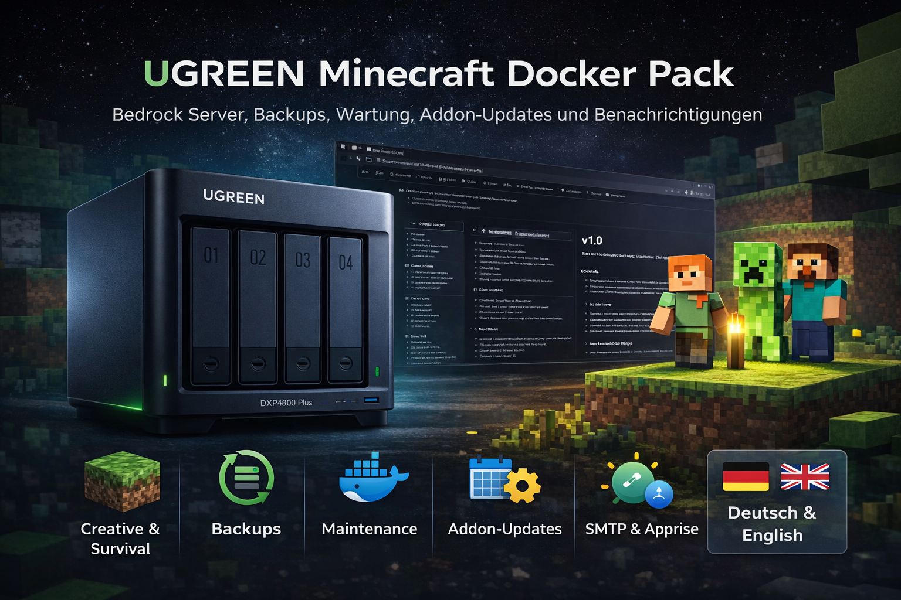

# UGREEN Minecraft Docker Pack

[](https://github.com/Railsimulatornet/UGREEN-NAS-Minecraft-Docker-Pack/actions/workflows/pack-release.yml)
[](https://github.com/Railsimulatornet/UGREEN-NAS-Minecraft-Docker-Pack/actions/workflows/dockerhub-minecraft-maintenance.yml)
[](https://github.com/Railsimulatornet/UGREEN-NAS-Minecraft-Docker-Pack/actions/workflows/compose-validate.yml)
[](LICENSE)



[Deutsch](#deutsch) · [English](#english)

## Deutsch

Das Docker Pack bündelt einen oder zwei Minecraft-Bedrock-Server, Bedrockifier-Backups und Wartungsdienste für UGREEN NAS mit UGOS. Du kannst Creative und Survival einzeln oder gemeinsam betreiben und Benachrichtigungen über SMTP oder Apprise versenden.

Dies ist ein Community-Projekt. Es ist kein offizielles UGREEN-Produkt; die Nutzung erfolgt auf eigene Verantwortung.

### Funktionen

- Vollständiger UGOS-Projektordner unter `minecraft_server/`
- Creative- und Survival-Server über Compose-Profile auswählen
- Backups mit einstellbaren Zielen, Intervallen und Aufbewahrungszeiten
- Maintenance-Skripte für Addon-Updates, Tagesberichte und Watchdog-Prüfungen
- Kontrollierte Autoheal-Neustarts mit persistenter Historie
- Zweisprachige `.env`, relative Projektpfade und DE/EN-Installationshandbuch

### Voraussetzungen

- Docker mit Docker Compose und Unterstützung für Profile, zum Beispiel über die UGOS-Docker-App
- Eine Host-Architektur, die zu den gewählten Bedrock- und Backup-Images passt
- Ausreichend Arbeitsspeicher und Speicherplatz für Welten, Backups und Addons
- Passende Datei- und Ordnerrechte für `COMMON_UID` und `COMMON_GID`
- Freie Ports für die gewählten Server und optional SMTP- oder Apprise-Zugang

Prüfe die Minecraft-EULA vor dem Start und setze `MC_EULA=TRUE`, wenn du ihr zustimmst. Die mitgelieferte `.env` enthält bereits Beispielwerte für zwei Server.

### Schnellstart

1. Lade das Paket unter [Releases](https://github.com/Railsimulatornet/UGREEN-NAS-Minecraft-Docker-Pack/releases/latest) herunter oder verwende den Repository-Inhalt.
2. Kopiere den vollständigen Ordner `minecraft_server/` in deine Docker-Freigabe.
3. Passe die mitgelieferte `.env` an: Profile, Benutzerrechte, Datenpfade, Servernamen, Ports und Benachrichtigungen.
4. Öffne in UGOS **Docker → Projekt → Erstellen** und wähle den vorhandenen Ordner `minecraft_server`.
5. Importiere die vorhandene `docker-compose.yaml`, stelle das Projekt bereit und warte den ersten Start vollständig ab.

Alternativ per SSH aus dem Projektordner:

```bash
cd minecraft_server
docker compose config --quiet
docker compose pull
docker compose up -d
docker compose ps
```

Für ein bereits vorhandenes UGOS-Projekt verwendest du dessen tatsächlichen Compose-Namen. Er steht im Container-Label `com.docker.compose.project` und kann mit `docker compose -p NAME` angegeben werden.

### Konfiguration

Die [.env](minecraft_server/.env) enthält die vollständige deutsche und englische Beschreibung. Die [Compose-Datei](minecraft_server/docker-compose.yaml) zeigt, wie die Werte verwendet werden.

| Einstellung | Vorgabe | Bedeutung |
| --- | --- | --- |
| `COMPOSE_PROFILES` | `creative,survival` | Beide Server; alternativ nur `creative` oder `survival` |
| `COMMON_UID` / `COMMON_GID` | `1000` / `10` | Benutzer und Gruppe für Server- und Backup-Dateien |
| `STACK_TZ` | `Europe/Berlin` | Zeitzone |
| `MAINTENANCE_LANG` | `de` | Maintenance-Ausgaben auf Deutsch oder mit `en` auf Englisch |
| `CREATIVE_DATA_DIR` / `SURVIVAL_DATA_DIR` | `./creative/data` / `./survival/data` | Persistente Welten |
| `CREATIVE_HOST_PORT_UDP` | `19133` | Creative-Spielport, in Compose für TCP und UDP verwendet |
| `SURVIVAL_HOST_PORT_TCP` / `SURVIVAL_HOST_PORT_UDP` | `19132` / `19132` | Survival-Spielports |
| `BACKUP_TARGETS` | `active` | Aktive Server sichern; auch einzelne Profile oder `none` möglich |
| `BACKUP_INTERVAL` / `BACKUP_MIN_INTERVAL` | `30m` / `30m` | Backup-Intervall und Mindestabstand |
| `BACKUP_KEEP_DAYS` / `BACKUP_MIN_KEEP` | `14` / `7` | Aufbewahrungsdauer und Mindestanzahl je Welt |
| `NOTIFY_CHANNEL` | `auto` | SMTP mit Apprise-Fallback; alternativ `smtp`, `apprise` oder `none` |
| `SMTP_*`, `MAIL_FROM`, `MAIL_TO` | eigene Werte | Mailserver und Empfänger |
| `APPRISE_URL` | leer | Vollständige Notify-URL für Apprise |
| `AUTOHEAL_STATE_HOST_DIR` | `./autoheal-state` | Persistente Autoheal-Neustarthistorie |

#### Autoheal im Docker Pack

Standardmäßig überwacht Autoheal den Backup-Service über das Label `com.railsimulatornet.minecraft.autoheal=true`. Auswahl und Label des Backup-Services verwenden dieselben Compose-Vorgaben. Bei Bedarf kannst du sie mit `MINECRAFT_AUTOHEAL_LABEL` und `MINECRAFT_AUTOHEAL_LABEL_VALUE` in `.env` anpassen.

| Autoheal-Einstellung | Vorgabe |
| --- | --- |
| `AUTOHEAL_START_PERIOD` | `120` Sekunden |
| `AUTOHEAL_INTERVAL` | `30` Sekunden |
| `AUTOHEAL_DEFAULT_STOP_TIMEOUT` | `10` Sekunden |
| `AUTOHEAL_COOLDOWN` | `300` Sekunden |
| `AUTOHEAL_MAX_RESTARTS` | `3` |
| `AUTOHEAL_RESTART_WINDOW` | `1800` Sekunden |
| `AUTOHEAL_DRY_RUN` / `AUTOHEAL_LOG_LEVEL` | `false` / `info` |

Für einen Test stehen `AUTOHEAL_DRY_RUN=true` und `AUTOHEAL_LOG_LEVEL=debug` bereit. Das Neustartlimit kann mit `AUTOHEAL_MAX_RESTARTS=0` deaktiviert werden; der Cooldown bleibt aktiv.

Der Backup-Healthcheck prüft den internen TCP-Port `8080`. Seine Startphase beträgt mit der mitgelieferten Konfiguration `150s`. Die Ereignisdaten unter `autoheal-state/` bleiben auch nach dem Neuerstellen des Autoheal-Containers erhalten.

#### Paket- und Image-Versionen

| Bestandteil | Stand in diesem Paket |
| --- | --- |
| Docker Pack | `1.1.5` |
| Maintenance-Image | `railsimulatornet/minecraft-maintenance:1.0.3` |
| Autoheal-Image | `railsimulatornet/autoheal:1.0.0` |

Das Maintenance-Image wird für `linux/amd64` und `linux/arm64` gebaut. Beide Architekturen werden geprüft, bevor dasselbe Image veröffentlicht wird. Behebbare HIGH- oder CRITICAL-Funde sowie Scanfehler blockieren die Veröffentlichung. Das Image enthält SBOM- und Provenance-Attestierungen.

Der feste Maintenance-Tag `1.0.3` bleibt bei wöchentlichen Wartungsbuilds unverändert; diese aktualisieren `latest`. Die produktive Compose-Datei verwendet den festen Tag. Das im Pack festgelegte Autoheal-Image unterstützt ebenfalls AMD64 und ARM64.

### Aktualisierung

Behalte deine eigene `.env`, Welten, Backups, Addons und Autoheal-Daten. Übernimm neue Skripte und Compose-Änderungen gezielt in das bestehende Projekt. Vergleiche insbesondere neue oder geänderte `AUTOHEAL_*`-Werte und die oben beschriebene Label-Auswahl.

Führe im vorhandenen Projektordner aus:

```bash
docker compose config --quiet
docker compose pull
docker compose up -d
docker compose ps
```

In UGOS kannst du das bestehende Projekt neu bereitstellen und dabei die aktuellen Images abrufen. Behalte die festen Image-Tags aus dem Paket bei, wenn du genau diesen Stand verwenden möchtest.

### Kontrolle und Sicherheit

Prüfe nach Start und Update die Service-Zustände sowie die letzten Logs:

```bash
docker compose ps
docker compose logs --tail=100 minecraftserver_backup minecraftserver_maintenance minecraftserver_autoheal
```

Kontrolliere bei Backup-Problemen `BACKUP_TARGETS`, die aktiven Profile und die eingebundenen Pfade. Bei Versandproblemen prüfst du `NOTIFY_CHANNEL` sowie die SMTP- oder Apprise-Einstellungen.

Maintenance und Autoheal verwenden `/var/run/docker.sock`. Dieser Zugriff ermöglicht weitreichende Kontrolle über Docker und damit faktisch über den Host. Verwende vertrauenswürdige Images und schütze Projektdateien sowie Docker-Zugriff vor unberechtigten Änderungen.

### Projektstruktur

| Pfad | Inhalt |
| --- | --- |
| `minecraft_server/.env` | Zweisprachige Konfiguration |
| `minecraft_server/docker-compose.yaml` | Vollständiger Docker-Stack |
| `minecraft_server/creative/` / `survival/` | Daten der beiden Server |
| `minecraft_server/backup/` | Backup-Konfiguration, Skripte und Daten |
| `minecraft_server/maintenance/` | Wartungsskripte, Cron-Konfiguration und Statusdateien |
| `minecraft_server/addons_repo/` | Lokale Addon-Dateien |
| `minecraft_server/autoheal-state/` | Persistente Neustarthistorie |

`Dockerfile.mc_maintenance` bleibt im Repository als Build-Quelle. Die produktive Compose-Datei nutzt das veröffentlichte Image. Das bereinigte Benutzer-ZIP enthält deshalb keine Maintenance-Dockerfile.

### Dokumentation

- [Installationshandbuch Deutsch/Englisch](UGREEN_Minecraft_Docker_Pack_Installation-DE-EN.pdf)
- [Maintenance-Image](minecraft_server/DOCKERHUB_README.md)
- [Autoheal-Dokumentation](https://github.com/Railsimulatornet/autoheal)
- [Releases](https://github.com/Railsimulatornet/UGREEN-NAS-Minecraft-Docker-Pack/releases)

### Lizenz

[MIT License](LICENSE) · Copyright (c) 2026 Roman Glos / Railsimulatornet.

## English

The Docker Pack combines one or two Minecraft Bedrock servers, Bedrockifier backups and maintenance services for UGREEN NAS with UGOS. Run creative and survival separately or together, and send notifications through SMTP or Apprise.

This is a community project, not an official UGREEN product. Use it at your own risk.

### Features

- Complete UGOS project directory under `minecraft_server/`
- Select creative and survival servers through Compose profiles
- Configurable backup targets, intervals and retention
- Maintenance scripts for addon updates, daily reports and watchdog checks
- Controlled Autoheal restarts with persistent history
- Bilingual `.env`, relative project paths and a DE/EN installation handbook

### Requirements

- Docker with Docker Compose and profile support, for example through the UGOS Docker app
- A host architecture supported by the selected Bedrock and backup images
- Enough memory and storage for worlds, backups and addons
- Appropriate file and directory permissions for `COMMON_UID` and `COMMON_GID`
- Available ports for the selected servers, and optional SMTP or Apprise credentials

Review the Minecraft EULA before starting and set `MC_EULA=TRUE` if you accept it. The supplied `.env` already contains example values for two servers.

### Quick start

1. Download the package from [Releases](https://github.com/Railsimulatornet/UGREEN-NAS-Minecraft-Docker-Pack/releases/latest), or use the repository files.
2. Copy the complete `minecraft_server/` directory into your Docker share.
3. Adjust the supplied `.env`: profiles, user permissions, data paths, server names, ports and notifications.
4. In UGOS, open **Docker → Project → Create** and select the existing `minecraft_server` directory.
5. Import its `docker-compose.yaml`, deploy the project and allow the first startup to finish.

Alternatively, start through SSH from the project directory:

```bash
cd minecraft_server
docker compose config --quiet
docker compose pull
docker compose up -d
docker compose ps
```

For an existing UGOS project, use its actual Compose name. It is recorded in the container label `com.docker.compose.project` and can be passed through `docker compose -p NAME`.

### Configuration

The [.env](minecraft_server/.env) contains the complete German and English descriptions. The [Compose file](minecraft_server/docker-compose.yaml) shows how the values are used.

| Setting | Supplied value | Purpose |
| --- | --- | --- |
| `COMPOSE_PROFILES` | `creative,survival` | Both servers; alternatively only `creative` or `survival` |
| `COMMON_UID` / `COMMON_GID` | `1000` / `10` | User and group for server and backup files |
| `STACK_TZ` | `Europe/Berlin` | Time zone |
| `MAINTENANCE_LANG` | `de` | German maintenance output; set to `en` for English |
| `CREATIVE_DATA_DIR` / `SURVIVAL_DATA_DIR` | `./creative/data` / `./survival/data` | Persistent worlds |
| `CREATIVE_HOST_PORT_UDP` | `19133` | Creative game port, used for TCP and UDP in Compose |
| `SURVIVAL_HOST_PORT_TCP` / `SURVIVAL_HOST_PORT_UDP` | `19132` / `19132` | Survival game ports |
| `BACKUP_TARGETS` | `active` | Back up active servers; individual profiles or `none` are also supported |
| `BACKUP_INTERVAL` / `BACKUP_MIN_INTERVAL` | `30m` / `30m` | Backup interval and minimum spacing |
| `BACKUP_KEEP_DAYS` / `BACKUP_MIN_KEEP` | `14` / `7` | Retention period and minimum backup count per world |
| `NOTIFY_CHANNEL` | `auto` | SMTP with Apprise fallback; alternatively `smtp`, `apprise` or `none` |
| `SMTP_*`, `MAIL_FROM`, `MAIL_TO` | your values | Mail server and recipients |
| `APPRISE_URL` | empty | Complete Apprise notify URL |
| `AUTOHEAL_STATE_HOST_DIR` | `./autoheal-state` | Persistent Autoheal restart history |

#### Autoheal in the Docker Pack

By default, Autoheal monitors the backup service through the label `com.railsimulatornet.minecraft.autoheal=true`. Its selection and the backup service label use the same Compose defaults. You can customize them through `MINECRAFT_AUTOHEAL_LABEL` and `MINECRAFT_AUTOHEAL_LABEL_VALUE` in `.env`.

| Autoheal setting | Supplied value |
| --- | --- |
| `AUTOHEAL_START_PERIOD` | `120` seconds |
| `AUTOHEAL_INTERVAL` | `30` seconds |
| `AUTOHEAL_DEFAULT_STOP_TIMEOUT` | `10` seconds |
| `AUTOHEAL_COOLDOWN` | `300` seconds |
| `AUTOHEAL_MAX_RESTARTS` | `3` |
| `AUTOHEAL_RESTART_WINDOW` | `1800` seconds |
| `AUTOHEAL_DRY_RUN` / `AUTOHEAL_LOG_LEVEL` | `false` / `info` |

For testing, use `AUTOHEAL_DRY_RUN=true` and `AUTOHEAL_LOG_LEVEL=debug`. Setting `AUTOHEAL_MAX_RESTARTS=0` disables the count limit; the cooldown remains active.

The backup healthcheck tests internal TCP port `8080`. The supplied configuration uses a `150s` start period. Event data in `autoheal-state/` persists when the Autoheal container is recreated.

#### Package and image versions

| Component | Version in this package |
| --- | --- |
| Docker Pack | `1.1.5` |
| Maintenance image | `railsimulatornet/minecraft-maintenance:1.0.3` |
| Autoheal image | `railsimulatornet/autoheal:1.0.0` |

The maintenance image is built for `linux/amd64` and `linux/arm64`. Both architectures are checked before the same image is published. Fixable HIGH or CRITICAL findings and scan errors block publication. The image includes SBOM and provenance attestations.

Weekly maintenance builds update `latest` while preserving the fixed maintenance tag `1.0.3`. The production Compose file uses the fixed tag. The Autoheal image selected by the pack also supports AMD64 and ARM64.

### Updating

Keep your customized `.env`, worlds, backups, addons and Autoheal data. Apply new scripts and Compose changes to the existing project. Compare new or changed `AUTOHEAL_*` values and the label selection described above.

Run from the existing project directory:

```bash
docker compose config --quiet
docker compose pull
docker compose up -d
docker compose ps
```

In UGOS, redeploy the existing project and pull its current images. Keep the fixed image tags supplied by the pack when you want to use that exact version.

### Checks and security

After startup and updates, check service status and recent logs:

```bash
docker compose ps
docker compose logs --tail=100 minecraftserver_backup minecraftserver_maintenance minecraftserver_autoheal
```

For backup problems, check `BACKUP_TARGETS`, active profiles and mounted paths. For delivery problems, check `NOTIFY_CHANNEL` and your SMTP or Apprise settings.

Maintenance and Autoheal use `/var/run/docker.sock`. This provides extensive control over Docker and effectively the host. Use trusted images and protect project files and Docker access from unauthorized changes.

### Project structure

| Path | Contents |
| --- | --- |
| `minecraft_server/.env` | Bilingual configuration |
| `minecraft_server/docker-compose.yaml` | Complete Docker stack |
| `minecraft_server/creative/` / `survival/` | Data for both servers |
| `minecraft_server/backup/` | Backup configuration, scripts and data |
| `minecraft_server/maintenance/` | Maintenance scripts, cron configuration and status files |
| `minecraft_server/addons_repo/` | Local addon files |
| `minecraft_server/autoheal-state/` | Persistent restart history |

`Dockerfile.mc_maintenance` remains in the repository as the build source. The production Compose file uses the published image. The clean user ZIP therefore excludes the maintenance Dockerfile.

### Documentation

- [German/English installation handbook](UGREEN_Minecraft_Docker_Pack_Installation-DE-EN.pdf)
- [Maintenance image](minecraft_server/DOCKERHUB_README.md)
- [Autoheal documentation](https://github.com/Railsimulatornet/autoheal)
- [Releases](https://github.com/Railsimulatornet/UGREEN-NAS-Minecraft-Docker-Pack/releases)

### License

[MIT License](LICENSE) · Copyright (c) 2026 Roman Glos / Railsimulatornet.
